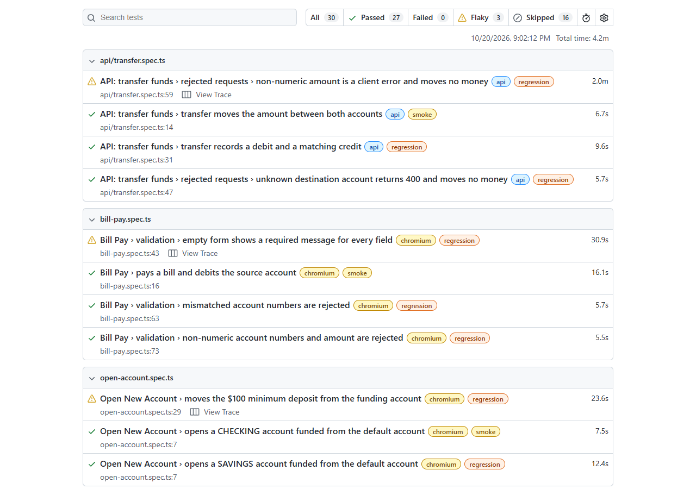

# ParaBank Playwright Automation

[](https://github.com/zoro460/parabank-playwright-ai/actions/workflows/playwright.yml)

End-to-end UI and REST API test automation for [ParaBank](https://parabank.parasoft.com/parabank), Parasoft's public online-banking demo, built with Playwright and TypeScript.

The suite covers login, opening accounts, fund transfers, bill pay, loan requests and the banking REST API. It includes a test that makes a transfer through the UI and then checks the result through the API. It is written to cope with what makes this target difficult: a shared instance whose data resets without warning, forms without accessible labels, and a Cloudflare layer that rate-limits automated traffic.

## Highlights

- **46 tests** (23 UI, 23 API) across Chromium, Firefox and WebKit; the API suite runs once rather than once per browser.
- **Page Object Model** with custom Playwright fixtures. Each test registers its own fresh user, so tests are independent and can run in parallel.
- **Typed API client** (`api/ParaBankApi.ts`) built on Playwright's `request` fixture, with back-off when the server returns 429.
- **Delta-based assertions**: balances are compared against values read just before an action, never against hard-coded totals, because the shared demo can hand out accounts with leftover balances.
- **15 confirmed defects** (logged as D1–D16; D11 was later ruled out) found during exploratory testing. Tests for open defects assert the *correct* behaviour and are marked `test.fail()`, so the suite stays green and flags when a defect gets fixed.
- **Environment-aware skipping**: when Cloudflare shows a bot check or a rate-limit page instead of ParaBank, the test is skipped with a clear reason instead of timing out and being reported as an app failure.
- **CI on GitHub Actions**: smoke tests on every push and PR, and the full suite every night.

## Tech stack

| Area | Tool |
| --- | --- |
| Test runner | [Playwright Test](https://playwright.dev) 1.64 |
| Language | TypeScript (Node.js LTS) |
| Design pattern | Page Object Model and custom fixtures |
| API testing | Playwright `APIRequestContext` |
| Config | `dotenv` (`.env` for URLs and credentials) |
| Reporting | Playwright HTML report, with traces on the first retry |
| CI | GitHub Actions |
| Exploration | `playwright-cli` (headed browser sessions) |

## Folder structure

```
parabank-playwright-ai/
├── .github/workflows/
│   └── playwright.yml        # CI: smoke on push/PR, full suite nightly
├── api/
│   └── ParaBankApi.ts        # Typed REST client (customers, accounts, transfers, transactions)
├── docs/
│   ├── test-scenarios.md     # Exploratory test notes, scenarios and defect log (D1–D16)
│   ├── screenshots/          # Screenshots captured while exploring the app
│   └── images/               # README images
├── fixtures/
│   └── test.ts               # Custom fixtures: newUser, registeredUser, loggedInPage, twoAccounts, api, page objects
├── pages/                    # Page objects
│   ├── AccountsOverviewPage.ts
│   ├── BillPayPage.ts
│   ├── LoginPage.ts
│   ├── OpenAccountPage.ts
│   ├── RegisterPage.ts
│   ├── RequestLoanPage.ts
│   ├── TransferFundsPage.ts
│   └── formRow.ts            # Locator helper for ParaBank's unlabeled table forms
├── tests/
│   ├── api/                  # REST API tests, plus a UI → API consistency test
│   ├── bill-pay.spec.ts
│   ├── login.spec.ts
│   ├── open-account.spec.ts
│   ├── request-loan.spec.ts
│   └── transfer-funds.spec.ts
├── utils/
│   ├── cloudflare.ts         # Detects Cloudflare bot-check and rate-limit pages and skips the test
│   └── money.ts              # Currency parsing and formatting
├── .env.example
└── playwright.config.ts      # Projects: api, chromium, firefox, webkit
```

## Getting started

### Prerequisites

- Node.js 18 or later (LTS recommended)
- npm

### Install

```bash
git clone https://github.com/zoro460/parabank-playwright-ai.git
cd parabank-playwright-ai
npm ci
npx playwright install --with-deps
```

### Configure

Copy the example environment file and set a password for the throwaway users that the tests register:

```bash
cp .env.example .env
```

```dotenv
BASE_URL=https://parabank.parasoft.com/parabank
TEST_USER_PASSWORD=<any password>
```

The test run stops with a clear error if either value is missing. No credentials are hard-coded in the code.

## Running tests

```bash
# Everything: API project plus Chromium, Firefox and WebKit
npx playwright test

# What CI runs: API plus Chromium
npx playwright test --project=api --project=chromium

# A single browser or the API suite only
npx playwright test --project=chromium
npx playwright test --project=api

# A single file, or by test title
npx playwright test tests/transfer-funds.spec.ts
npx playwright test -g "transfers between own accounts"

# Headed or debug mode
npx playwright test --project=chromium --headed
npx playwright test --project=chromium --debug

# Open the last HTML report
npx playwright show-report
```

Because ParaBank is a slow, shared public demo behind Cloudflare, the config keeps concurrency low (2 workers locally, 1 on CI, and the API project always uses 1 worker). It also allows retries (1 locally, 2 on CI).

## Test tags

Every test has a tag, so you can pick a slice of the suite with `--grep`.

| Tag | Meaning | Count |
| --- | --- | --- |
| `@smoke` | Critical happy paths: login, open account, transfer, bill pay, loan, and the core API calls | 10 |
| `@regression` | Everything else: negative paths, validation, edge cases, API error handling | 36 |
| `@known-issue` | Tests for defects that are still open (also tagged `@regression`). They assert the correct behaviour under `test.fail()`, and each test name includes its defect ID, e.g. `(D4)` | 10 |

```bash
npx playwright test --grep @smoke
npx playwright test --grep @regression --grep-invert @known-issue
npx playwright test --grep @known-issue
```

If ParaBank fixes one of the known issues, its `test.fail()` test starts passing unexpectedly, which Playwright reports as a failure. That failure is the signal to remove the marker.

## Continuous integration

[`.github/workflows/playwright.yml`](.github/workflows/playwright.yml) runs on GitHub Actions (Ubuntu, Chromium):

| Trigger | Scope |
| --- | --- |
| Push / pull request to `main` | `@smoke` tests |
| Nightly (02:00 IST) | Full suite |
| Manual (`workflow_dispatch`) | Full suite |

CI runs only the smoke tests on pushes and PRs because Cloudflare rate-limits GitHub-hosted runners partway through a full run. `BASE_URL` comes from a repository variable and `TEST_USER_PASSWORD` from a repository secret. The HTML report is uploaded as a build artifact and kept for 30 days.

## HTML report



*A local run of the api and chromium projects. Skipped tests were blocked by Cloudflare (each one shows the reason in the report). Flaky tests passed on retry, and a trace was recorded for each of them.*

## How I built this: workflow and tooling

I built this framework with Claude Code as a pair-programming assistant and `playwright-cli` as the browser driver. The approach was the same throughout: I set the direction, standards and acceptance criteria, used the AI to speed up exploration and the first drafts of code, and treated everything it produced as a draft that I reviewed, tested and corrected before committing.

### 1. Setting the rules first

Before writing any tests, I wrote a [`CLAUDE.md`](CLAUDE.md) with the project's conventions:

- Page Object Model only
- role- or label-based locators, with no XPath or CSS chains
- no `waitForTimeout`
- credentials only from `.env`
- a fresh user per test

The assistant followed these in every session, and I used them as my review checklist.

### 2. Exploring the app before automating it

I explored ParaBank in a headed browser with `playwright-cli`, driving it through Claude Code. I walked through every feature: registration, login, accounts, transfers, bill pay, find transactions, profile updates, loans and the REST API. I tried positive, negative and edge-case inputs throughout. I wrote down what I observed in [`docs/test-scenarios.md`](docs/test-scenarios.md), with screenshots in [`docs/screenshots/`](docs/screenshots/).

This exploration shaped the framework more than anything else. It found:

- **The demo resets often.** Users were wiped three times in one 30-minute session. This is why every test registers its own user and every balance check is a delta.
- **Inputs have no accessible labels**, so `getByLabel` cannot work. I designed the `formRow()` helper to anchor on each field's caption cell, which keeps locators role-based and still works when a validation message appears in the same row.
- **15 confirmed defects**, including an unauthenticated REST API (D13), negative and overdraft transfers being accepted (D1, D2, D15), and internal errors where the app should show field validation (D4, D6).

### 3. Generating the tests

I had the assistant draft page objects, fixtures and specs from the scenarios I had documented, one feature area at a time (one commit per area). I decided which scenarios became `@smoke`, which became `@regression`, and how known defects would be handled: assert the correct behaviour under `test.fail()` instead of skipping the test or asserting the buggy behaviour.

### 4. Debugging failures

When tests failed, I used Playwright traces, the HTML report's error context and `playwright-cli` to reproduce the steps live. The main cases:

- **CI failures that did not happen locally.** I traced them to Cloudflare, first to its bot check and then to Error 1015 rate limiting. My fix was to detect both pages and skip the test with a clear reason, instead of retrying. Retrying would only have extended the ban and tripled the run time.
- **The nightly job was running only the smoke tests.** I found that the workflow expression `cond && '' || '--grep @smoke'` always evaluates to the smoke filter, because `''` is falsy in GitHub Actions. I fixed it by putting the non-empty value first.
- **Cloudflare blocked tests on pages other than registration.** Tests that never register a user, such as the empty-login test, still failed when the rate-limit page replaced the login page. I moved the check into a shared helper, and every page object's `goto()` now uses it.

### 5. What I reviewed and corrected by hand

Every change went through my own review before it was committed. Things I caught and changed include:

- **Locators**: replaced brittle or attribute-based selectors with role-based ones, and made sure each one matches exactly one element on the real page.
- **Assertions**: changed hard-coded balances to before/after deltas after I saw new accounts open with leftover balances.
- **Test data**: removed the site-wide loan provider name from the loan test's expectations, because other users of the shared demo can change it.
- **Safety**: made sure that nothing calls the API's `cleanDB` or `initializeDB` endpoints, which would wipe data for everyone using the shared demo.
- **Flakiness**: tuned retries, worker counts and timeouts for a slow public demo, and checked that no test uses `waitForTimeout`.
- **CI design**: split smoke and full runs between push/PR and nightly after seeing where the rate limit started blocking runs.

The commit history shows how the project was built: exploration first, then the framework, then each feature, then the CI hardening.

## Known limitations

- ParaBank is a shared public demo. Its data can reset at any time, and Cloudflare may block automated traffic, so some tests can be skipped on a given run. This comes from the environment, not from the tests.
- CI runs on Chromium only, to stay within the rate limit. Firefox and WebKit run locally.
- Find Transactions, Update Contact Info and Registration validation are documented in `docs/test-scenarios.md` but not yet automated.
